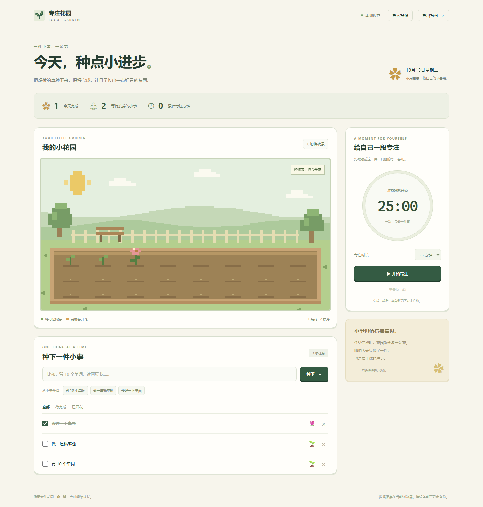

# 像素专注花园 🌱

把小任务种成一座花园：添加任务时长出嫩芽，完成后开花。配合可暂停的专注计时，把一天里的小进步留住。

原生 HTML / CSS / JavaScript，**没有第三方运行依赖，也不需要账号或数据库**。下载后打开 `dist/index.html` 就能使用。



截图中的 3 项任务是浏览器检查时创建的演示数据。首次打开应用，任务和累计专注记录都为空。

## 能做什么

- **任务花园**：添加、完成、撤销完成、删除任务；支持全部 / 待完成 / 已开花筛选。
- **像素场景**：Canvas 逐块绘制植物、花床、树木、长椅与日夜场景，没有外部图片请求。
- **专注计时**：15 / 25 / 45 分钟或自定义 1—180 分钟；暂停、继续、重置，完成后累计专注分钟。
- **刷新恢复**：任务、场景与计时状态保存在当前浏览器；运行中的计时按结束时间恢复，暂停时不消耗剩余时间。
- **备份迁移**：导出 JSON，导入前检查格式、编号、时间、时长与统计；覆盖已有记录前会确认。
- **手机适配**：窄屏自动改成单列布局；键盘操作、可见焦点、任务标签与状态提示均可用。

## 最简单的打开方式

1. 下载项目 ZIP 并解压。
2. 双击 `dist/index.html`。
3. 输入一件小事，点击「种下」；完成时勾选任务。

如果打开了不支持本地保存的浏览器环境，页面会明确提示临时模式，可用「导出备份」保留当前记录。

## 也可以用本地服务打开

安装 Node.js 20 或更新版本，在项目目录运行：

```powershell
node scripts/serve.cjs
```

浏览器访问 `http://127.0.0.1:8765`。不需要执行依赖安装。若想换端口：

```powershell
$env:PORT="8766"
node scripts/serve.cjs
```

从本地文件、不同端口或不同网站地址打开，会使用各自独立的浏览器存储。切换访问方式、设备或浏览器前，可以先导出，再在新位置导入。

## 关于花园和记录

- 花园展示最近 24 项任务，列表最多保留 300 项。
- 今天完成数和待办数基于当前任务列表；删除任务也会移除对应植物和完成统计。
- 累计专注分钟独立保存，删除任务不会减少它。
- 刷新或关闭网页不会自动暂停正在运行的计时；重新打开时，已经到期的一轮会补记一次。
- 计时依赖设备时钟。时钟手动大幅调整时，剩余时间也可能变化。
- 初次使用没有预填任务、假完成数或默认专注记录。

## 项目结构

```text
focus-garden/
├── dist/
│   ├── index.html         # 页面与可访问的交互控件
│   ├── style.css          # 桌面 / 手机布局
│   ├── core.js            # 任务、计时、备份验证的纯函数
│   ├── app.js             # DOM、Canvas 与本地存储
│   └── favicon.svg       # 原生像素图标
├── scripts/serve.cjs      # Node 内置 HTTP 模块提供的本地服务
├── tests/
│   ├── core.test.cjs      # 13 项逻辑测试，无须浏览器
│   └── browser.cjs        # 真实 Chrome / Edge 交互检查与截图
├── docs/
│   ├── 开发笔记.md
│   ├── 验证记录.md
│   ├── 桌面演示.png
│   └── 手机演示.png
└── .github/workflows/检查.yml
```

## 运行检查

```powershell
# 任务、计时状态与备份规则
node --test tests/core.test.cjs

# 可选：实际启动隐藏的 Chrome / Edge 检查交互，并生成截图
node tests/browser.cjs
```

浏览器检查需要 Node.js 22 或更新版本，会优先使用 `CHROME_PATH`，再查找常见 Chrome / Edge 安装位置。所有测试任务、浏览器配置和下载文件都放在项目的 `.runtime`，不会使用日常浏览器配置。

```powershell
$env:CHROME_PATH="C:/Program Files/Google/Chrome/Application/chrome.exe"
node tests/browser.cjs
```

GitHub Actions 会检查脚本语法并运行逻辑测试。本机浏览器结果见 [验证记录](docs/验证记录.md)。

## 可以继续做的小功能

- 为任务设置不同植物和花床。
- 增加每天的专注记录视图。
- 添加可选的计时结束提示音。

实现思路与值得读的代码见 [开发笔记](docs/开发笔记.md)。
